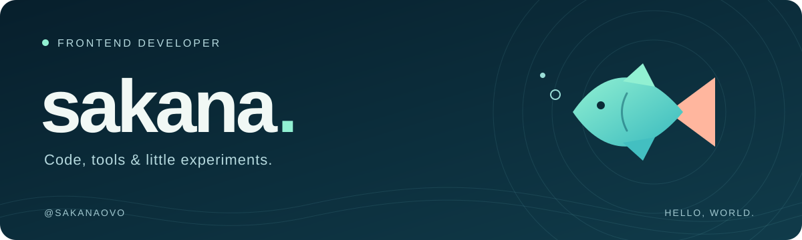

  

<h1 align="center">你好，我是 sakana 🐟</h1>

  一名修 bug 的前端工程师。 
  做一些小工具，也通过手写实现和测试学习前端。

  <a href="https://github.com/sakanaovo?tab=repositories">代码仓库</a> ·
  <a href="https://juejin.cn/user/1935603769810264/posts">掘金文章</a> ·
  <a href="#联系我">联系我</a>

## 01 / 作品与练习

<table>
  <tr>
    <td width="50%" valign="top">
      <h3><a href="https://github.com/sakanaovo/variable-prompt">variable-prompt</a></h3>
      
VS Code CSS 变量提示插件。通过手动配置的映射，提供输入提示与悬停查看变量值的功能。

      
<code>VS Code</code> <code>CSS</code> <code>开发工具</code>

    </td>
    <td width="50%" valign="top">
      <h3><a href="https://github.com/sakanaovo/private-kitchen">private-kitchen</a></h3>
      
手写常用库与工具函数的学习记录。用 TDD 思路和 Vitest 测试，在 monorepo 中边写边学。

      
<code>TypeScript</code> <code>Vitest</code> <code>TDD</code>

    </td>
  </tr>
  <tr>
    <td width="50%" valign="top">
      <h3><a href="https://github.com/sakanaovo/mini-react-ts">mini-react-ts</a></h3>
      
用 TypeScript 拆分实现 mini-react，通过动手实践理解 React 的实现思路。

      
<code>React</code> <code>TypeScript</code> <code>Vite</code>

    </td>
    <td width="50%" valign="top">
      <h3><a href="https://github.com/DevCloudFE/vue-devui">Vue DevUI</a></h3>
      
参与 Vue 3 组件库的开源贡献，包括弹窗按钮自动聚焦，以及图片预览组件的修复。

      
<a href="https://github.com/DevCloudFE/vue-devui/pull/1560">功能贡献 #1560</a> · <a href="https://github.com/DevCloudFE/vue-devui/pull/1561">修复 #1561</a>

    </td>
  </tr>
</table>

## 02 / 文章与记录

我在 **[掘金](https://juejin.cn/user/1935603769810264/posts)** 记录前端开发、工具实践和学习心得。

`前端开发` · `工具实践` · `手写实现` · `学习笔记`

## 联系我

欢迎交流前端开发、开源项目和学习心得。

**微信：`mtx1125l`**（添加时请备注来意）

 

感谢你游到这里。🐟

